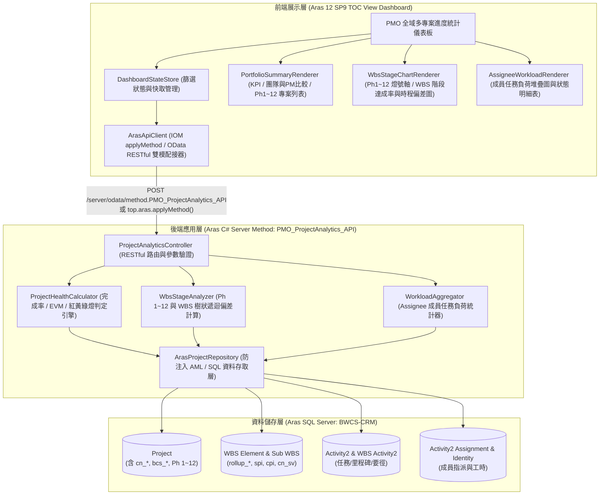
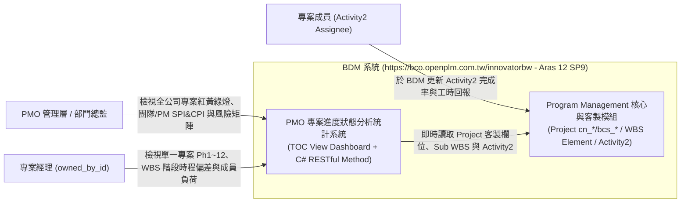
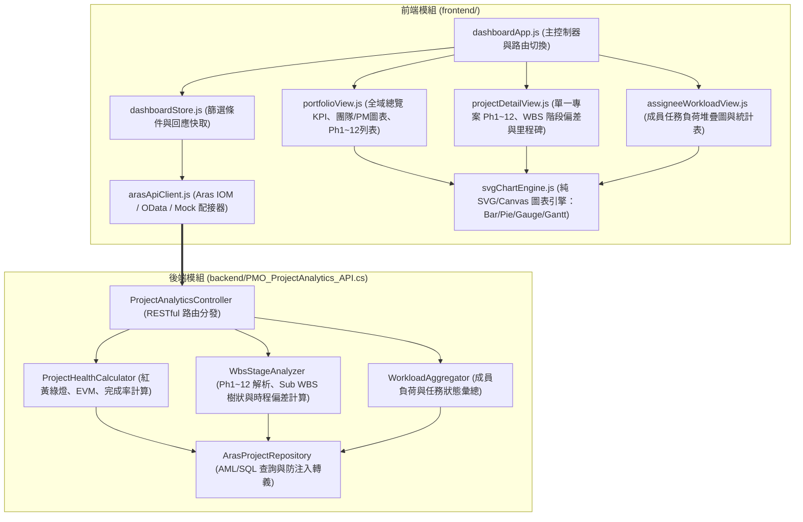
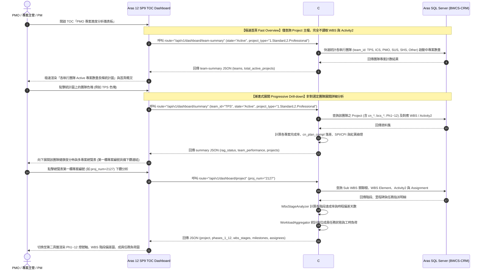
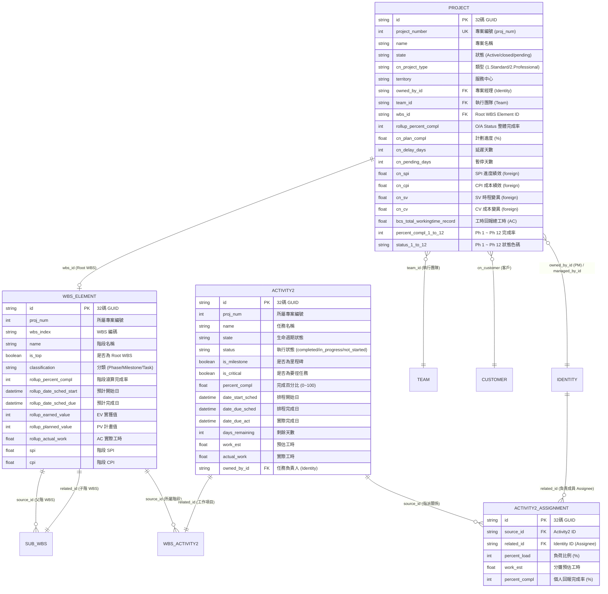
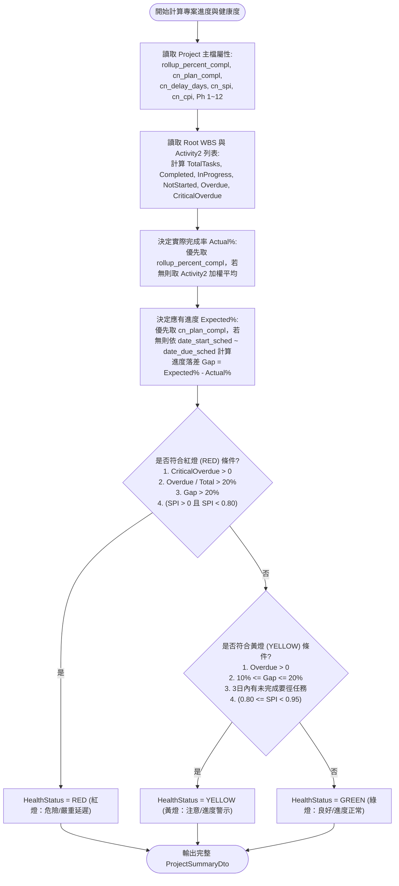
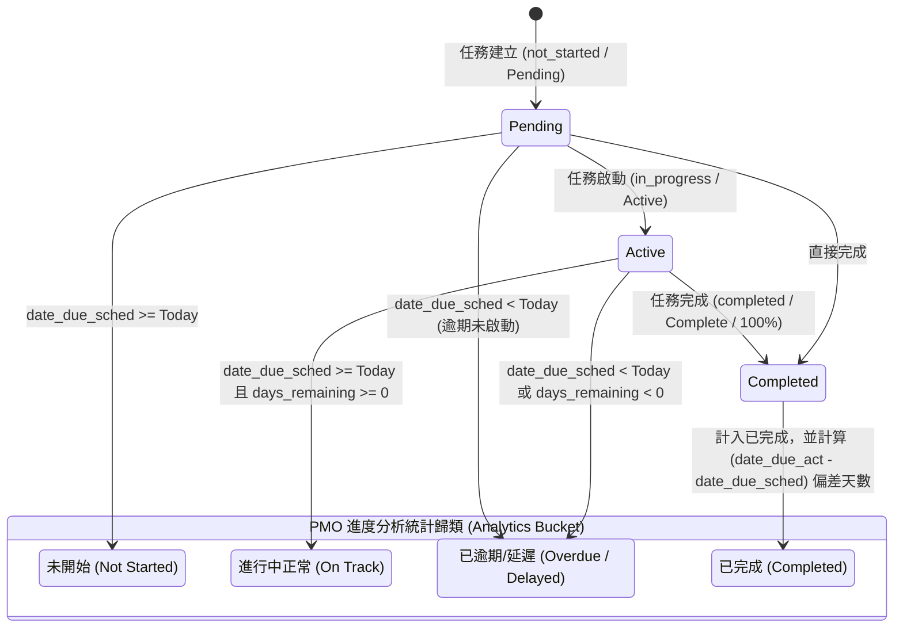

# BDM 系統專案進度狀態分析統計功能 — 系統規格書 (`spec.md`)

> **目標系統**：`https://bco.openplm.com.tw/innovatorbw` (資料庫：`BWCS-CRM`)  
> **平台版本**：Aras Innovator 12 SP9  
> **基準模組**：Aras Program Management (`Project` / `WBS Element` / `Sub WBS` / `WBS Activity2` / `Activity2` / `Activity2 Assignment`)  
> **參考架構**：整合 `Project` ItemType 客製化屬性 (`cn_*`, `bcs_*`, `Ph 1~12`) 與 `C:\TEST\pmomonthly` RESTful API 路由設計  
> **部署形式**：AML Package + C# Server Method (RESTful Controller) + TOC View 全域多專案總覽儀表板 (HTML5/CSS3/ES6)

---

## 1. 架構與選型 (Architecture & Technology Stack)

### 1.1 技術選型說明
- **伺服器端 (Backend)**：Aras Innovator 12 SP9 內建 **C# (.NET Framework) Server Method (`PMO_ProjectAnalytics_API`)**。
  - 採用 **RESTful Controller 路由架構**（對齊 `pmomonthly` 之 `/api/v1/dashboard/*` 端點語意），同時支援：
    1. **Aras OData RESTful API**：`POST /server/odata/method.PMO_ProjectAnalytics_API`（支援 Bearer Token / OAuth 2.0）。
    2. **Aras IOM Client API**：`top.aras.applyMethod("PMO_ProjectAnalytics_API", "<aml/>")`（在 Aras TOC 內免二次登入直接存取）。
  - **極速分層響應架構 (Fast Overview & Progressive Drill-down)**：
    首頁載入時提供極速輕量端點 `/api/v1/dashboard/team-summary`，僅檢索 Project 主檔並聚合團隊專案數，完全繞過龐大的 WBS 與 Activity2 關聯運算，將首頁渲染時間降至毫秒級。
- **客戶端 (Frontend)**：掛載於 Aras TOC (Table of Contents `Portfolio` / `Dashboards` 類別) 的 **獨立全域多專案儀表板 (`PMO_ProgressDashboard.html`)**。
  - 採用遵循 S.O.L.I.D 原則之原生模組化 JavaScript + 響應式現代深淺雙模 UI 與原生 SVG/Canvas 互動圖表引擎（零外部網路依賴，確保內網與 iframe 嵌入 100% 穩定執行）。
  - 首頁優先載入「各執行團隊 (team_id) 專案數量長條統計圖」，長條圖統計結果即時聯動篩選條件（依專案狀態、專案類型、服務中心等動態聚合計算），點擊長條圖各團隊色塊即漸進展開該團隊之多專案進度詳細分析。
  - 專案類型 (`cn_project_type`) 支援 9 大完整類型複選 (OR 比對：`1.Standard`, `2.Professional`, `3.Upgrade`, `4.Customize`, `5.Product`, `6.Technical`, `7.Marketing`, `8.EmployeeTraining`, `F.Misc`)，預設選中 `1.Standard` 與 `2.Professional`；專案狀態 (`state`) 預設為 `Active`；執行團隊選項清單純淨顯示為 `TPS`、`ICS`、`PMO`、`SUS`、`SHS`、`Other`（嚴禁附加「XX團隊」等冗餘中文後綴；後端支援 Team GUID 快取映射與 `team_id/@keyed_name` 雙重解析，確保準確依團隊計量，杜絕全部歸入 Other）。
  - 總覽表取消獨立下鑽操作欄位，將下鑽連結整合至第一欄專案編號。

### 1.2 架構圖


---

## 2. 資料模型與客製化欄位映射 (Data Model & Custom Properties)

依據貴司提供的 `Project` ItemType 定義報表與 `pmomonthly` 實戰經驗，完整欄位映射如下：

### 2.1 `Project` ItemType 標準與客製化欄位表
| 分類 | 屬性名稱 (Property Name) | 標籤 (Label) | 型別 | 系統統計與分析用途 |
| :--- | :--- | :--- | :--- | :--- |
| **識別與基本資訊** | `project_number` | 專案編號 | integer | 專案唯一業務編號 (`proj_num`，排序與關聯鍵) |
| | `name` | 名稱 | string (64) | 專案名稱 |
| | `state` | 狀態 | string (32) | 生命週期狀態 (`Active`, `closed`, `pending`) |
| | `cn_project_type` | 類型 | list | 專案類型 (`1.Standard`, `2.Professional` 等) |
| | `classification` | 專案類別 | string (512) | 類別 (`1.Standard`, `5.Product`, `2.Professional`...) |
| | `territory` | 服務中心 | list | 服務中心別 (`Service Center`) |
| | `cn_pj_mode` | 專案模式 | list | 專案執行模式 (`bcs_project_mode`) |
| | `cn_customer` | 客戶 | item (`Customer`) | 客戶名稱 (`@aras.keyed_name`) |
| | `bcs_po_no` | 訂單編號 | string (32) | 訂單編號 |
| **組織與團隊** | `owned_by_id` | 專案經理 | item (`Identity`) | 專案經理 (PM) ID 與名稱 |
| | `managed_by_id` | 專案主管 | item (`Identity`) | 專案主管 ID 與名稱 |
| | `team_id` | 執行團隊 | item (`Team`) | 負責團隊 ID 與名稱 |
| | `wbs_id` | WBS | item (`WBS Element`) | 根節點 Root WBS Element ID |
| **Ph 1 ~ Ph 12 階段** | `percent_compl_1` ~ `12` | Ph 1 ~ Ph 12 | integer | 專案主檔自帶第 1~12 階段完成百分比 (`0~100`) |
| | `status_1` ~ `status_12` | Ph 1 ~ Ph 12 | color list | 專案主檔自帶第 1~12 階段狀態色碼 (如 `#67C23A`/`#FFD800`/`#F56C6C`) |
| **進度與狀態燈號** | `rollup_percent_compl` | O/A Status | integer | 系統滾算整體完成率 (%) |
| | `bcs_rollup_percent_compl`| bcs_rollup_percent_compl | foreign | Root WBS 滾算完成率 (%) |
| | `cn_wbs_compl` | Complete | foreign | WBS 完成度 (%) |
| | `cn_plan_compl` | 計劃進度 | float | 當前應達成之計劃進度基準 (`ExpectedProgress %`) |
| | `bcs_project_status` | Status Color | color list | 系統原生專案狀態色碼 |
| | `bcs_project_status_label`| Status Label | string (32) | 系統原生專案狀態文字標籤 |
| | `bcs_project_compl_cate` | 進度區間 | string (20) | 完成進度區間分類 |
| **排程、基準與延遲** | `date_start_sched` / `date_due_sched` | 排程開始/完成日期 | date | 當前排程起訖日 |
| | `date_start_target` / `date_due_target` | 目標起始/完成時間 | date | 目標基準起訖日 |
| | `date_start_act` / `date_due_act` | 實際開始 / Act Finish | date | 實際起訖日 |
| | `cn_init_plan_start` | 原訂計畫啟始日 | date | 原始 Baseline 啟始日 |
| | `cn_init_plan_finish` | 原訂上線驗收日 | date | 原始 Baseline 上線驗收日 |
| | `cn_initial_comp` | 原訂系統驗收日 | date | 原始系統驗收日 |
| | `cn_closed_date` | 結案日 | date | 實際結案日期 |
| | `cn_delay_days` | Delay Days | integer | 專案延遲天數 |
| | `cn_pending_days` | Pending Days | integer | 專案暫停天數 |
| **EVM 與工時指標** | `cn_pv` / `cn_ev` / `cn_ac` | PV / EV / AC | foreign | 計畫值 / 實獲值 / 實際工時成本 (來自 Root WBS) |
| | `cn_sv` / `cn_cv` | SV時程變異 / CV成本變異 | foreign | 時程變異 / 成本變異 |
| | `cn_spi` / `cn_cpi` | SPI / CPI | foreign | 進度績效指標 / 成本績效指標 |
| | `cn_exp_mandays` | 原始規劃人天 | float | 原始規劃人天 |
| | `cn_exp_mandays_c1` | 原始規劃執行工時 | float | 原始規劃執行工時 |
| | `cn_wbs_rolwrkest` | 規劃預計工時 | foreign | WBS 滾算預計總工時 (`rollup_work_est`) |
| | `bcs_total_work_time` | AC實報總工時 | float | 實報總工時 |
| | `bcs_total_workingtime_record` | 工時回報總工時 | float | `Project WorkTime` 回報總工時 |
| | `cn_remainder` | 剩餘工時 | float | 剩餘工時 |
| | `cn_bug_imp_rate` | 預算執行率 | float | 預算執行率 (%) |

### 2.2 `WBS Element` 與 `Activity2` 關聯欄位
- **`WBS Element`**：`id`, `proj_num`, `wbs_index`, `name`, `is_top`, `classification` (`Phase`/`Milestone`/`Task`), `rollup_duration`, `rollup_status`, `rollup_percent_compl`, `rollup_date_sched_start`, `rollup_date_sched_due`, `rollup_date_start_act`, `rollup_earned_value`, `rollup_planned_value`, `rollup_work_est`, `rollup_actual_work`, `spi`, `cpi`, `cn_sv`, `cn_cv`, `owned_by_id`, `managed_by_id`, `team_id`。
  - *注意*：`WBS Element` 無 `parent_wbs_id` 屬性，父子階層由 `Sub WBS` (`source_id` -> `related_id`) 建立。
- **`Activity2`**：`id`, `proj_num`, `name`, `state`, `status`, `is_milestone`, `is_critical`, `percent_compl`, `work_est`, `actual_work`, `date_start_sched`, `date_due_sched`, `date_start_act`, `date_due_act`, `days_remaining`, `earned_value`, `planned_value`, `spi`, `cpi`, `cn_sv`, `cn_cv`, `owned_by_id`, `managed_by_id`, `team_id`。
- **`Activity2 Assignment`**：`source_id` (`Activity2`), `related_id` (`Identity` 專案成員), `percent_load`, `work_est`, `percent_compl`。

---

## 3. 關鍵流程與統計演算法 (Key Processes & Algorithms)

### 3.1 專案整體完成率、應有進度與健康度燈號 (`GREEN` / `YELLOW` / `RED`)
1. **整體實際完成率 (`ActualProgress`)**：
   - 優先取 `Project.rollup_percent_compl`（或 `bcs_rollup_percent_compl` / `cn_wbs_compl` / Root WBS 之 `rollup_percent_compl`）。
   - 若為空，則由專案下所有 `Activity2` 以 `work_est` 加權平均計算：
     $$\text{ActualProgress} = \frac{\sum_{i=1}^{n} (\text{percent\_compl}_i \times w_i)}{\sum_{i=1}^{n} w_i}$$
2. **應有計劃進度 (`ExpectedProgress`) 與進度落差 (`ProgressGap`)**：
   - 優先取 `Project.cn_plan_compl`（計劃進度 %）。
   - 若 `cn_plan_compl` 未填或為 0，則依當前日期 (`AsOfDate`) 與 `date_start_sched` ~ `date_due_sched` 線性插值計算應有進度百分比。
   - **進度落差**：$$\text{ProgressGap} = \text{ExpectedProgress} - \text{ActualProgress}$$
3. **健康度燈號 (`HealthStatus`：綠/黃/紅燈) 判定標準**：
   - **紅燈 (`RED` - 嚴重延遲)**（滿足任一條件）：
     - 存在已逾期未完成之里程碑 (`is_milestone = 1`) 或要徑任務 (`is_critical = 1`)；
     - 逾期任務佔比 $\frac{\text{OverdueTasks}}{\text{TotalTasks}} > 20\%$；
     - 整體進度落差 $\text{ProgressGap} > 20\%$；
     - 或 EVM 進度績效 $\text{SPI} > 0$ 且 $\text{SPI} < 0.80$。
   - **黃燈 (`YELLOW` - 進度警示)**（未達紅燈，且滿足任一條件）：
     - 逾期任務數 $\text{OverdueTasks} > 0$（佔比 $\le 20\%$）；
     - 整體進度落差 $10\% \le \text{ProgressGap} \le 20\%$；
     - 3 日內有即將到期但尚未完成的要徑任務 (`0 <= days_remaining <= 3` 且 `is_critical = 1`)；
     - 或 EVM 進度績效 $0.80 \le \text{SPI} < 0.95$。
   - **綠燈 (`GREEN` - 進度正常)**：
     - 無逾期任務、進度落差 $< 10\%$ 且 $\text{SPI} \ge 0.95$（或無異常指標）。

### 3.2 各階段 (`Ph 1~12` 與 `WBS Element`) 達成率與時程偏差分析
1. **專案主檔 `Ph 1 ~ Ph 12` 階段矩陣**：
   - 讀取 `percent_compl_1 ~ 12` 與 `status_1 ~ 12`，自動將色碼（如 `#00FF00`/`#FFD800`/`#FF0000` 或語意字串）標準化為 `GREEN`/`YELLOW`/`RED`/`GRAY`，供多專案總覽表與單一專案時間軸呈現。
2. **WBS 階段 (`WBS Element` & `Milestone`) 達成率與時程偏差**：
   - 針對 Root WBS 下轄之主階段 (`parent_wbs_id == root_wbs_id`) 與里程碑 (`classification == 'Milestone'` 或 `Activity2.is_milestone == 1`)：
     - 計算該階段完成率 (`rollup_percent_compl`)、EV、PV、AC、SPI、CPI、時程變異 (`cn_sv`)。
     - **階段時程偏差天數 (`ScheduleVarianceDays`)**：
       - 若階段已完成：$\text{ActualFinish} - \text{rollup\_date\_sched\_due}$。
       - 若階段未完成且已逾預計完成日：$\text{Today} - \text{rollup\_date\_sched\_due}$（正值表示延遲天數）。
       - 同時統計該階段下轄子任務之：`總數`、`已完成`、`進行中`、`未開始`、`已逾期`。

### 3.3 專案成員 (`Assignee`) 任務負荷與完成狀態統計
- 優先讀取 `Activity2 Assignment` 的指派成員 (`related_id`)，若該任務無 Assignment 子表紀錄，則回退讀取 `Activity2.owned_by_id`（若再無則讀取 `managed_by_id`）。
- 針對每位成員統計：
  - `totalTasks` (總指派任務數)
  - `completedTasks` (已完成任務數：`state == 'Complete'` 或 `status == 'completed'` 或 `percent_compl >= 100`)
  - `inProgressTasks` (進行中任務數：`0 < percent_compl < 100` 或 `state == 'Active'`)
  - `pendingTasks` (未開始任務數：`percent_compl == 0` 且未開始)
  - `overdueTasks` (已逾期未完成任務數：`date_due_sched < Today` 且未完成)
  - `criticalTasks` (負責之要徑任務數)
  - `totalEstHours` (總預估工時 `work_est`)、`totalActualHours` (總實報工時 `actual_work`)
  - `completionRate` (個人任務完成率 `%`)
  - `loadLevel` (負荷等級：依進行中+未開始任務數或剩餘工時判定 `HIGH` / `NORMAL` / `LOW`)

---

## 4. 虛擬碼 (Pseudocode)

```text
FUNCTION HandleRequest(requestItem, innovator):
    route = Sanitize(requestItem.getProperty("route", "/api/v1/dashboard/summary"))
    stateFilter = Sanitize(requestItem.getProperty("state", "Active"))
    typeFilter = Sanitize(requestItem.getProperty("project_type", "ALL"))
    teamFilter = Sanitize(requestItem.getProperty("team_id", "ALL"))
    pmFilter = Sanitize(requestItem.getProperty("pm_id", "ALL"))
    healthFilter = Sanitize(requestItem.getProperty("health_status", "ALL"))
    projNum = Sanitize(requestItem.getProperty("proj_num", ""))

    SWITCH route:
        CASE "/api/v1/dashboard/summary":
            projects = Repo.FetchProjects(stateFilter, typeFilter, teamFilter, pmFilter)
            rootWbsMap = Repo.FetchRootWbsByIds(projects.Select(p => p.WbsId))
            activitiesMap = Repo.FetchActivitiesByProjNums(projects.Select(p => p.ProjNum))

            summaries = []
            FOR EACH proj IN projects:
                wbs = rootWbsMap.Get(proj.WbsId)
                acts = activitiesMap.Get(proj.ProjNum)
                dto = HealthCalculator.ComputeProjectSummary(proj, wbs, acts, TODAY)
                IF healthFilter == "ALL" OR dto.HealthStatus == healthFilter:
                    summaries.Add(dto)

            kpi = HealthCalculator.BuildPortfolioKpi(summaries)
            teamPerf = HealthCalculator.GroupByTeam(summaries)
            pmPerf = HealthCalculator.GroupByPm(summaries)
            RETURN JsonResponse({
                summary: kpi,
                rag_status: kpi.RagDistribution,
                evm_summary: kpi.EvmSummary,
                team_performance: teamPerf,
                pm_performance: pmPerf,
                projects: summaries
            })

        CASE "/api/v1/dashboard/project":
            proj = Repo.FetchProjectByNumber(projNum)
            wbsTree = Repo.FetchWbsHierarchy(proj.WbsId, proj.ProjNum)
            acts = Repo.FetchActivitiesWithAssignments(proj.ProjNum, wbsTree.AllIds)
            projSummary = HealthCalculator.ComputeProjectSummary(proj, wbsTree.Root, acts, TODAY)
            phases1To12 = StageAnalyzer.ExtractPhases1To12(proj)
            wbsStages = StageAnalyzer.AnalyzeWbsStages(wbsTree, acts, TODAY)
            milestones = StageAnalyzer.ExtractMilestones(wbsTree, acts, TODAY)
            assignees = WorkloadAggregator.Aggregate(acts, TODAY)

            RETURN JsonResponse({
                project: projSummary,
                phases_1_12: phases1To12,
                wbs_stages: wbsStages,
                milestones: milestones,
                assignees: assignees
            })

        CASE "/api/v1/dashboard/wbs":
            proj = Repo.FetchProjectByNumber(projNum)
            wbsTree = Repo.FetchWbsHierarchy(proj.WbsId, proj.ProjNum)
            acts = Repo.FetchActivitiesWithAssignments(proj.ProjNum, wbsTree.AllIds)
            treeDto = StageAnalyzer.BuildFullWbsTreeAnalytics(wbsTree, acts, TODAY)
            RETURN JsonResponse(treeDto)

        CASE "/api/v1/dashboard/assignees":
            acts = Repo.FetchActivitiesForWorkload(projNum, stateFilter, teamFilter)
            assignees = WorkloadAggregator.Aggregate(acts, TODAY)
            RETURN JsonResponse({ assignees: assignees })
```

---

## 5. 系統脈絡圖 (System Context Diagram)



---

## 6. 模組關係圖 (Module Relationship Diagram)



---

## 7. 序列圖 (Sequence Diagram)



---

## 8. ER 圖 (Entity-Relationship Diagram)



---

## 9. 流程圖：專案與階段健康度綜合判定 (Flowchart)



---

## 10. 狀態圖：專案與任務統計狀態歸類 (State Diagram)



---

## 11. 後端關鍵類別圖與 RESTful API 規劃 (Class Diagram & RESTful Controller)

### 11.1 後端關鍵類別圖 (S.O.L.I.D 設計)

```mermaid
classDiagram
    class ProjectAnalyticsController {
        -IProjectRepository _repo
        -IProjectHealthCalculator _healthCalc
        -IWbsStageAnalyzer _stageAnalyzer
        -IWorkloadAggregator _workloadAggregator
        +Execute(Item requestItem, Innovator inn) Item
        +GetDashboardSummary(SummaryQuery query) string
        +GetTeamAnalysis(string teamId, SummaryQuery query) string
        +GetPmAnalysis(string pmId, SummaryQuery query) string
        +GetProjectAnalysis(int projNum) string
        +GetWbsAnalysis(int projNum) string
        +GetAssigneeWorkload(int projNum, string teamId) string
    }

    class IProjectRepository {
        <<interface>>
        +QueryProjects(SummaryQuery query) List~ProjectRecord~
        +QueryProjectByNumber(int projNum) ProjectRecord
        +QueryWbsElements(List~int~ projNums, List~string~ rootWbsIds) List~WbsRecord~
        +QueryActivities(List~int~ projNums) List~ActivityRecord~
    }

    class ArasProjectRepository {
        -Innovator _inn
        +QueryProjects(SummaryQuery query) List~ProjectRecord~
        +QueryProjectByNumber(int projNum) ProjectRecord
        +QueryWbsElements(List~int~ projNums, List~string~ rootWbsIds) List~WbsRecord~
        +QueryActivities(List~int~ projNums) List~ActivityRecord~
        +EscapeSql(string raw) string
    }

    class IProjectHealthCalculator {
        <<interface>>
        +ComputeProjectSummary(ProjectRecord proj, WbsRecord rootWbs, List~ActivityRecord~ acts, DateTime today) ProjectSummaryDto
        +ComputePortfolioSummary(List~ProjectSummaryDto~ projects) PortfolioDashboardDto
    }

    class ProjectHealthCalculator {
        +ComputeProjectSummary(ProjectRecord proj, WbsRecord rootWbs, List~ActivityRecord~ acts, DateTime today) ProjectSummaryDto
        +ComputePortfolioSummary(List~ProjectSummaryDto~ projects) PortfolioDashboardDto
        +EvaluateHealthLight(int totalTasks, int overdueTasks, int criticalOverdue, double progressGap, double spi) string
    }

    class IWbsStageAnalyzer {
        <<interface>>
        +ExtractPhases1To12(ProjectRecord proj) List~PhaseIndicatorDto~
        +AnalyzeStages(string rootWbsId, List~WbsRecord~ wbsList, List~ActivityRecord~ acts, DateTime today) List~WbsStageDto~
        +BuildWbsTree(string rootWbsId, List~WbsRecord~ wbsList, List~ActivityRecord~ acts, DateTime today) List~WbsTreeNodeDto~
    }

    class WbsStageAnalyzer {
        +ExtractPhases1To12(ProjectRecord proj) List~PhaseIndicatorDto~
        +AnalyzeStages(string rootWbsId, List~WbsRecord~ wbsList, List~ActivityRecord~ acts, DateTime today) List~WbsStageDto~
        +BuildWbsTree(string rootWbsId, List~WbsRecord~ wbsList, List~ActivityRecord~ acts, DateTime today) List~WbsTreeNodeDto~
    }

    class IWorkloadAggregator {
        <<interface>>
        +AggregateByAssignee(List~ActivityRecord~ acts, DateTime today) List~AssigneeWorkloadDto~
    }

    class WorkloadAggregator {
        +AggregateByAssignee(List~ActivityRecord~ acts, DateTime today) List~AssigneeWorkloadDto~
    }

    ProjectAnalyticsController --> IProjectRepository
    ProjectAnalyticsController --> IProjectHealthCalculator
    ProjectAnalyticsController --> IWbsStageAnalyzer
    ProjectAnalyticsController --> IWorkloadAggregator
    ArasProjectRepository ..|> IProjectRepository
    ProjectHealthCalculator ..|> IProjectHealthCalculator
    WbsStageAnalyzer ..|> IWbsStageAnalyzer
    WorkloadAggregator ..|> IWorkloadAggregator
```


### 11.2 RESTful API 路由規範 (對齊 `C:\TEST\pmomonthly`)
所有路由透過 `route` 參數分發（相容 FastAPI RESTful 路徑與 Aras Method `POST /server/odata/method.PMO_ProjectAnalytics_API`）：

| RESTful 路徑 (`route`) | 對應 Action 別名 | 查詢參數 | 回應內容摘要 |
| :--- | :--- | :--- | :--- |
| `GET /api/v1/dashboard/team-summary` | `GET_TEAM_SUMMARY` | `state` (預設 `Active`, 支援 `ALL`/`closed`/`pending`), `project_type` (支援 9 項複選), `territory`, `keyword` | **首頁極速統計**：僅查詢 Project 主檔並依 `team_id/@keyed_name` 解析分組彙整各執行團隊專案數，統計結果完全聯動篩選條件，數十毫秒秒開首頁長條圖 |
| `GET /api/v1/dashboard/summary` | `GET_PORTFOLIO_SUMMARY` | `state` (預設 `Active`), `project_type` (複選 OR), `territory`, `team_id`, `pm_id`, `health_status`, `keyword` | 全公司/多專案 KPI 彙總、紅黃綠燈 (`rag_status`) 統計、EVM 彙總、`team_performance`、`pm_performance`、含 `Ph 1~12` 與進度狀態之專案清單 |
| `GET /api/v1/dashboard/team/{team_id}` | `GET_TEAM_ANALYSIS` | `team_id`, `state` | 指定執行團隊 (`team_id`) 之專案進度、RAG 燈號分佈、PM 績效與風險專案明細 |
| `GET /api/v1/dashboard/pm/{pm_id}` | `GET_PM_ANALYSIS` | `pm_id`, `state` | 指定專案經理 (`owned_by_id`) 負責之所有專案完成率、時程偏差、EVM 與狀態統計 |
| `GET /api/v1/dashboard/project/{proj_num}` | `GET_PROJECT_DETAIL` | `proj_num` (專案編號或 ID) | 單一專案深度分析：基本與客製屬性 (`cn_*`/`bcs_*`)、`Ph 1~12` 階段燈號、主階段 `WBS Element` 達成率與時程偏差天數、里程碑進度、該專案成員任務負荷統計 |
| `GET /api/v1/dashboard/wbs/{proj_num}` | `GET_WBS_ANALYSIS` | `proj_num` | 單一專案完整 `WBS Element` 遞迴樹狀結構 (`wbs_tree`)、各層級完成度、SPI/CPI、時程偏差與下轄任務狀態 |
| `GET /api/v1/dashboard/assignees` | `GET_ASSIGNEE_WORKLOAD` | `proj_num` (選填), `team_id` (選填), `state` | 跨專案或單一專案之成員 (`Activity2.managed_by_id`) 任務負荷排行榜（扣除 `is_milestone == '1'` 里程碑任務忽略不計）：總任務、已完成、進行中、未開始、逾期數、要徑任務數、預估工時 (`work_est`)、實際工時 (`actual_work`)、完成率 (%) 與負荷等級 |
| `GET /api/v1/health` | `HEALTH_CHECK` | 無 | 系統健康檢查與版本資訊 |

---

## 12. Aras AML Package 封裝規範與部署架構 (Package Architecture & Deployment)

### 12.1 Aras Package 目錄結構規範
Aras Innovator 官方匯入工具 **`PackageImportExportUtilities`**（包含 `Import.exe` / `ConsoleUpgrade.exe`）採用標準目錄階層模型：
1. **清單檔 (`imports.mf`)**：
   定義包裹名稱與 AML 檔案所在目錄路徑：
   ```xml
   <imports>
     <package name="com.bdm.pmo.analytics" path="PMO_Analytics\Import" />
   </imports>
   ```
2. **ItemType 子目錄分割結構**：
   `Import.exe` 的 `LoadPackageDom` 核心引擎會執行 `Directory.GetDirectories(solutionPath)`。因此，匯入路徑下**嚴禁將 AML 檔案平鋪放置於根目錄**，必須依照欲建立/更新的 ItemType 類型劃分子資料夾：
   - `PMO_Analytics\Import\Method\PMO_ProjectAnalytics_API.xml`：封裝 C# RESTful Server Method。
   - `PMO_Analytics\Import\ItemType\PMO_Progress_Analytics.xml`：封裝全域多專案儀表板入口 ItemType 及其 TOC 關聯 (`TOC Access`、`TOC View`、`Allowed Permission`、`Can Add`)。

### 12.2 AML 動作屬性 (`action="add"` / `action="edit"`) 與 Merge 機制
- **標準動作宣告**：匯入 XML 根項目的 action 宣告需遵循以下原則：
  - 當建立全新物件時，使用 `action="add"`。
  - 當目標資料庫已存在該實體（如已透過 Web Client 或前次建立完成）時，根節點及其關聯子項目應指定為 `action="edit"`。
- **build.xsl 相依性排序機制**：
  Aras 工具在載入各子目錄的 AML 項目後，會透過內建 `build.xsl` 依據平台核心依賴順序重新排序。`build.xsl` 同時具備對 `AML/Item[@type='...'][@action='add']` 與 `AML/Item[@type='...'][@action='edit']` 的解析能力，會將 Method 與 ItemType 依照相依關係完整保留輸出。
- **避免重複建立引發之 CUI 衝突**：
  在 Aras 12 中，對已存在的 ItemType 執行 `action="add"` 會嘗試重新生成關聯之 `PresentationConfiguration`，進而觸發 SQL Primary Key 重複約束例外。將已就緒的 ItemType 宣告為 `action="edit"` 可直接執行就地安全屬性覆寫，並順利由 `Import.exe` 完成 PackageDefinition 的綁定與註冊。

### 12.3 TOC View 掛載機制與權限配置
`PMO_Progress_Analytics` ItemType 的目的為在 Aras Web Client 的左側目錄樹 (TOC) 中掛載進入點：
- **分類位置**：`Portfolio`。
- **檢視頁面**：`<start_page>../customer/pmo_static/index.html</start_page>`。
- **權限配置**：
  - `Allowed Permission`：關聯至目標資料庫 `Default Access` Permission（於 `BWCS-CRM` 中之標準 GUID 為 `9122CD065CF04141B8EFE263FC80BEA4`）。
  - `Can Add`：關聯至 `Administrators` Identity（GUID: `2618D6F5A90949BAA7E920D1B04C7EE1`）。
  - `TOC Access` / `TOC View`：授予 `World` Identity（GUID: `A73B655731924CD0B027E4F4D5FCC0A9`）。
- **依賴解析防護**：
  在 Aras 12 中，ItemType 建立時必須具備合法的 `Allowed Permission` 實體 ID，若參照不存在的 Permission ID，`Import.exe` 會將其標記為未解析參照 (Unresolved Reference) 並剝離該關聯，致使 Aras 核心 CUI `PresentationConfiguration` 自動生成邏輯因缺少預設權限而引發 SQL Primary Key 衝突例外。
- **運行模式**：使用者點擊 TOC 項目時，Aras Client 會在主工作區 iframe 內載入該 HTML5 儀表板，儀表板透過 `top.aras.applyMethod` 直接與後端 `PMO_ProjectAnalytics_API` 進行通訊。

